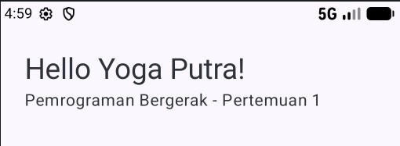

# PB01 - Hello World Android
Nama : Yoga Putra Yudistira
NIM : 0112524039
Kelas : IF24H
## Deskripsi
Aplikasi Android pertama menggunakan Kotlin dan Jetpack Compose.
## Hasil
Aplikasi menampilkan teks "Hello, World!" pada emulator/perangkat Android.
## Tools
- Android Studio
- Kotlin
- Jetpack Compose
- Git
## Bukti!
[screen1.png](images/screen1.png)
